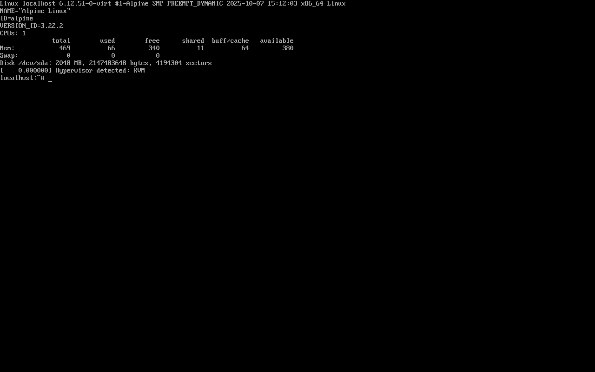

# PHY3645 – Thực tập Tin học ứng dụng · Bài tập 1

**Virtual environment · Virtual machine · Docker container · Python environment managers · Git/GitHub**
(kèm Phần 2: cài RDBMS và dùng thử SQL)

- Sinh viên: _(họ tên – MSSV)_
- Máy chạy demo: laptop Windows 11 (x64)
- Toàn bộ output trong README được lấy từ log của lần chạy thật, xem thư mục [`logs/`](logs/).

## Mục lục
1. [Lý thuyết](#1-lý-thuyết)
2. [Demo các Python environment manager](#2-demo-python-environment-managers)
3. [Demo Docker container](#3-demo-docker-container)
4. [Demo máy ảo (VirtualBox)](#4-demo-máy-ảo-virtualbox)
5. [Git & GitHub](#5-git--github)
6. [Phần 2 – RDBMS và SQL](#6-phần-2--rdbms-và-sql)
7. [Cấu trúc repo & cách chạy lại](#7-cấu-trúc-repo--cách-chạy-lại)
8. [Tài liệu tham khảo](#8-tài-liệu-tham-khảo)

---

## 1. Lý thuyết

### 1.1 Vấn đề cần giải quyết
Hai project trên cùng một máy thường cần những thứ mâu thuẫn nhau: project A cần `numpy 1.x` và Python 3.9, project B cần `numpy 2.x` và Python 3.12. Ngoài ra, code chạy được trên máy mình nhưng lỗi trên máy người khác ("works on my machine") vì khác hệ điều hành, thư viện hệ thống hoặc phiên bản. Có ba mức **cô lập (isolation)** để giải quyết, từ nhẹ đến nặng:

```
  VIRTUAL ENVIRONMENT        CONTAINER (Docker)          VIRTUAL MACHINE
+---------+---------+    +-----------+-----------+   +-------------+-------------+
|  App A  |  App B  |    |   App A   |   App B   |   |    App A    |    App B    |
| .venv A | .venv B |    | libs + OS | libs + OS |   |    libs     |    libs     |
| (pkgs)  | (pkgs)  |    | userland  | userland  |   |  Guest OS   |  Guest OS   |
+---------+---------+    +-----------+-----------+   | + KERNEL    | + KERNEL    |
|    Interpreter    |    |  Container engine     |   +-------------+-------------+
+-------------------+    +-----------------------+   |   Hypervisor (VirtualBox, |
|  Host OS + kernel |    |  Host OS + KERNEL     |   |   Hyper-V, KVM, VMware)   |
+-------------------+    |  (dùng chung)         |   +---------------------------+
|     Phần cứng     |    +-----------------------+   |  Host OS  /  Phần cứng    |
+-------------------+    |       Phần cứng       |   +---------------------------+
                         +-----------------------+
  cô lập: package          cô lập: process, FS,        cô lập: cả máy (khác kernel)
                           mạng, thư viện hệ thống
```

### 1.2 Virtual environment (môi trường ảo Python)
- Là **một thư mục** (vd. `.venv/`) chứa: file `pyvenv.cfg`, bản sao/liên kết tới trình thông dịch Python, và thư mục `site-packages` **riêng**.
- `activate` chỉ đơn giản là đưa `.venv\Scripts` lên đầu biến `PATH`, nên lệnh `python`/`pip` trỏ vào môi trường đó. Trong Python, `sys.prefix` trỏ vào thư mục venv, khác `sys.base_prefix` (Python gốc).
- **Cô lập được:** package Python và phiên bản của chúng.
  **Không cô lập:** hệ điều hành, kernel, thư viện hệ thống (CUDA, libssl…), biến môi trường, mạng.
- Rất nhẹ (vài chục MB), tạo trong vài giây, không tốn RAM thêm.
- Thường đi kèm một file khai báo (`requirements.txt`, `pyproject.toml` + lockfile, `environment.yml`) để người khác tái tạo **đúng** môi trường. Thư mục môi trường thì **không** commit lên Git.

### 1.3 Virtual machine (máy ảo)
- **Hypervisor** giả lập một máy tính hoàn chỉnh: CPU ảo (dùng tập lệnh ảo hoá VT-x/AMD-V), RAM, ổ đĩa ảo (`.vdi`, `.vmdk`, `.vhdx`), card mạng, card đồ hoạ… Trên đó cài một **hệ điều hành khách (guest OS) đầy đủ, có kernel riêng**.
- Hai loại hypervisor:
  - **Type 1 (bare-metal):** chạy trực tiếp trên phần cứng: VMware ESXi, Microsoft Hyper-V, KVM, Xen. Dùng trong data center/cloud.
  - **Type 2 (hosted):** chạy như một ứng dụng trên OS host: **VirtualBox**, VMware Workstation. Tiện cho cá nhân.
- **Ưu:** cô lập mạnh nhất (khác cả kernel: chạy Linux trên Windows, chạy OS cũ, thử malware…), snapshot/rollback toàn bộ máy.
  **Nhược:** nặng (vài GB đĩa, phải cấp cứng RAM/CPU), khởi động mất hàng chục giây đến vài phút, hiệu năng thấp hơn máy thật.

### 1.4 Container (Docker)
- Container **không giả lập phần cứng** và **không có kernel riêng**. Nó là một (nhóm) **process bình thường trên kernel Linux của host**, nhưng bị “nhốt” bởi các tính năng của kernel:
  - **Namespaces**: mỗi container thấy cây process (`pid`), mạng (`net`), filesystem (`mnt`), hostname (`uts`), IPC, user… của riêng nó. Ví dụ: trong container, `ps` chỉ thấy vài process và process đầu tiên có PID 1.
  - **cgroups**: giới hạn tài nguyên (CPU, RAM, I/O) cho từng container.
  - **Union filesystem (OverlayFS)**: image gồm nhiều **layer** chỉ đọc xếp chồng; container thêm một layer ghi được ở trên cùng. Các container dùng chung layer nên tiết kiệm đĩa.
- Thuật ngữ:
  - **Image**: “khuôn” đóng gói app + thư viện + userland của một distro (Debian, Alpine…), build từ **Dockerfile**.
  - **Container**: một instance đang chạy của image (`docker run`).
  - **Registry**: kho image (Docker Hub, GHCR) — `docker pull/push`.
- **Trên Windows/macOS:** container Linux cần kernel Linux, nên Docker Desktop chạy một **máy ảo Linux nhỏ** (trên Windows là **WSL2**, dùng Hyper-V) và mọi container dùng chung kernel của máy ảo đó. Demo ở mục 3 chứng minh điều này.
- **Ưu:** nhẹ (MB), khởi động trong ~1 giây, tái tạo y hệt môi trường ở mọi máy (dev → server), đóng gói cả thư viện hệ thống.
  **Nhược:** cô lập yếu hơn VM (chung kernel, nên lỗ hổng kernel ảnh hưởng tất cả), không chạy được OS có kernel khác (container Windows cần host Windows).

### 1.5 So sánh tổng hợp

| Tiêu chí | Virtual environment | Container (Docker) | Virtual machine |
|---|---|---|---|
| Cô lập cái gì | Package của **một ngôn ngữ** (Python) | Process, filesystem, mạng, thư viện hệ thống, userland OS | **Toàn bộ máy**: phần cứng ảo + OS + kernel |
| Kernel | Của host | **Dùng chung** kernel host | **Riêng** (guest OS) |
| Cơ chế | Thư mục riêng + `PATH` | Namespaces + cgroups + OverlayFS | Hypervisor ảo hoá phần cứng |
| Kích thước | ~10–100 MB | ~5 MB (Alpine) – vài trăm MB | Vài GB |
| Khởi động | Tức thì | ~1 giây | Hàng chục giây – vài phút |
| Overhead RAM/CPU | Gần như 0 | Rất thấp | Cao (cấp cứng RAM/CPU) |
| Mang sang máy khác | File khai báo (`requirements.txt`, `uv.lock`…) | Image / Dockerfile | File đĩa ảo / OVA |
| Dùng khi | Phát triển, học Python hằng ngày | Deploy app, microservice, CI/CD, chạy DB | Cần OS/kernel khác, cô lập bảo mật cao, lab mạng |

Ba cách này **kết hợp** chứ không loại trừ nhau: thực tế thường là *VM trên cloud → chạy Docker → trong image dùng venv/uv*.

### 1.6 Các Python environment manager

| Công cụ | Là gì | Quản lý **phiên bản Python**? | Quản lý **package** | File khai báo |
|---|---|---|---|---|
| **venv** | Module có sẵn trong Python ≥ 3.3 | Không (dùng Python đang chạy) | `pip` | `requirements.txt` |
| **virtualenv** | Bản mở rộng của venv (pip install) – tạo env nhanh hơn, cấu hình nhiều hơn, chọn được Python khác đã cài | Chọn trong các bản đã cài | `pip` | `requirements.txt` |
| **pyenv** (Windows: **pyenv-win**) | Cài và chuyển đổi **nhiều phiên bản Python** song song (`global`, `local`, `shell`) | **Có** | Không (kết hợp với venv) | `.python-version` |
| **conda** (Miniconda/Anaconda) | Trình quản lý package + môi trường **đa ngôn ngữ**, gói binary dựng sẵn | **Có** | `conda` (+ `pip`), cả package **không phải Python** (CUDA, MKL, R…) | `environment.yml` |
| **uv** (Astral, viết bằng Rust) | “Tất cả trong một”: thay cho pip + venv + pyenv + pip-tools + pipx, rất nhanh | **Có** (`uv python install`) | **Có**, có **lockfile** | `pyproject.toml` + `uv.lock` |

Khi nào dùng gì:
- Script nhỏ, không muốn cài thêm gì → **venv**.
- Project Python mới, muốn nhanh và tái tạo chính xác → **uv**.
- Cần nhiều phiên bản Python trên máy (test 3.9 → 3.13) → **pyenv** (hoặc `uv python`).
- Data science/ML cần thư viện C/C++/CUDA đã biên dịch sẵn → **conda**.
- Cần cả thư viện hệ thống/OS giống hệt production → **Docker**.

---

## 2. Demo Python environment managers

Cả 5 công cụ đều chạy **cùng một file** [`demo_app/check_env.py`](demo_app/check_env.py) (in ra phiên bản Python, đường dẫn interpreter, `sys.prefix` và phiên bản `requests`). Script tự động: [`scripts/1_python_envs.ps1`](scripts/1_python_envs.ps1) · log đầy đủ: [`logs/1_python_envs.log`](logs/1_python_envs.log).

### 2.1 Kết quả tổng hợp (chạy thật trên cùng một laptop)

| Môi trường | Python | `requests` | `sys.prefix` | `prefix != base_prefix` |
|---|---|---|---|---|
| Python hệ thống (không env) | 3.13.7 | _(chưa cài)_ | `...\Programs\Python\Python313` | False |
| **venv** | 3.13.7 | **2.31.0** | `01-venv\.venv` | **True** |
| **virtualenv** | 3.13.7 | **2.28.2** | `02-virtualenv\.venv` | **True** |
| **uv** | **3.11.15** (uv tự tải) | **2.32.3** | `03-uv\.venv` | **True** |
| **pyenv-win** | **3.10.11** | _(chưa cài)_ | `~\.pyenv\pyenv-win\versions\3.10.11` | False |
| **conda** | **3.9.23** | **2.27.1** | `~\miniconda3\envs\phy3645-demo` | False |

Nhận xét:
- Trên **một máy**, cùng lúc tồn tại **4 phiên bản Python** (3.9, 3.10, 3.11, 3.13) và **4 phiên bản `requests`** mà không xung đột. Đó chính là việc các công cụ này giải quyết.
- **venv / virtualenv / uv** tạo *virtual environment* thật sự: `sys.prefix` trỏ vào thư mục `.venv` nên `prefix != base_prefix` là `True`.
- **pyenv** chỉ **cài và chọn phiên bản Python** (file `.python-version`), bản thân nó không tạo venv. Thực tế hay dùng kết hợp: `pyenv local 3.10.11`, sau đó `python -m venv .venv`.
- **conda env** là một bản cài Python **độc lập hoàn toàn** (có `python.exe` riêng trong `envs\phy3645-demo`), không phải venv nên phép kiểm tra trả về `False`, nhưng vẫn cô lập. Conda tự tải cả `openssl`, `tk`, `vc14_runtime`… (thư viện C, không phải Python). Đây là điểm khác biệt lớn với pip.
- Chi tiết thú vị: các bản Python cũ hơn (3.9, 3.10, 3.11 trong demo) báo `platform.release()` là **"10"** dù máy chạy Windows 11, còn bản 3.13 báo đúng "11". Windows 11 vẫn mang số phiên bản nội bộ 10.0, Python mới nhận diện thêm theo build number. Đây không phải lỗi môi trường.

### 2.2 Lệnh dùng cho từng công cụ

**venv** (có sẵn trong Python):
```powershell
python -m venv .venv
.venv\Scripts\activate            # Linux/macOS: source .venv/bin/activate
pip install requests==2.31.0
pip freeze > requirements.txt     # người khác tái tạo bằng: pip install -r requirements.txt
deactivate
```

**virtualenv**:
```powershell
pip install --user virtualenv
python -m virtualenv .venv        # rồi activate / pip y như venv
```
Log: `created virtual environment CPython3.13.7 ... seeder FromAppData ... activators Bash, Batch, Fish, Nushell, PowerShell, Python, Xonsh`, tức là virtualenv sinh sẵn script activate cho nhiều shell hơn venv.

**uv**:
```powershell
irm https://astral.sh/uv/install.ps1 | iex     # cài uv
uv init --name uv-demo --python 3.11          # tạo pyproject.toml + .python-version
uv python install 3.11                        # uv tự tải Python 3.11 (không cần cài trước)
uv add requests==2.32.3                       # tạo .venv, cài package, ghi uv.lock
uv run python ..\demo_app\check_env.py        # chạy trong env mà không cần activate
```
Trích log: `Installed Python 3.11.15 in 20.88s` · `Resolved 6 packages in 2.47s` · `Installed 5 packages in 290ms`.
Kết quả: [`03-uv/pyproject.toml`](03-uv/pyproject.toml) + [`03-uv/uv.lock`](03-uv/uv.lock) (lockfile ghi chính xác version + hash của mọi package, kể cả phụ thuộc gián tiếp).

**pyenv-win**:
```powershell
pyenv install 3.10.11     # tải installer từ python.org, cài vào ~\.pyenv\pyenv-win\versions\
pyenv local 3.10.11       # ghi file .python-version -> trong thư mục này "python" = 3.10.11
pyenv versions            # * 3.10.11 (set by ...\04-pyenv\.python-version)
pyenv global 3.13.7       # (đổi bản mặc định toàn máy)
```

**conda**:
```powershell
conda create -n phy3645-demo -c conda-forge python=3.9 requests=2.27 -y
conda activate phy3645-demo
conda env export --from-history > environment.yml    # tái tạo: conda env create -f environment.yml
conda env list
```


---

## 3. Demo Docker container

Cài **Docker Desktop** (backend **WSL2**) bằng `winget install Docker.DockerDesktop`. Script: [`scripts/2_docker.ps1`](scripts/2_docker.ps1) · log đầy đủ: [`logs/2_docker.log`](logs/2_docker.log).

```text
> docker --version
Docker version 29.9.3, build 5457199
> docker info
OS=Docker Desktop | Kernel=6.6.87.2-microsoft-standard-WSL2 | CPUs=12 | MemTotal=3933417472
```
Docker chạy trong một máy ảo Linux (WSL2) với kernel `6.6.87.2-microsoft-standard-WSL2` và khoảng 3.7 GB RAM, tức một phần RAM của laptop (7.7 GB).

### 3.1 Tự build image từ Dockerfile
[`06-docker/Dockerfile`](06-docker/Dockerfile):
```dockerfile
FROM python:3.12-slim                                 # image gốc: Debian slim + Python 3.12
WORKDIR /app                                          # thư mục làm việc trong container
COPY requirements.txt .
RUN pip install --no-cache-dir -r requirements.txt    # layer cài thư viện (được cache)
COPY app.py .                                         # sửa code chỉ build lại layer này
CMD ["python", "app.py"]                              # lệnh chạy khi start container
```
```text
> docker build -t phy3645-env-demo 06-docker
#4 [1/5] FROM docker.io/library/python:3.12-slim
#6 [2/5] WORKDIR /app
#7 [3/5] COPY requirements.txt .
#8 [4/5] RUN pip install --no-cache-dir -r requirements.txt
#9 [5/5] COPY app.py .
#10 naming to docker.io/library/phy3645-env-demo:latest

> docker run --rm phy3645-env-demo
Hello from inside a Docker container!
hostname    : e776da52412b (= container ID)
os (userland): Debian GNU/Linux 13 (trixie)
kernel      : Linux 6.6.87.2-microsoft-standard-WSL2
python      : 3.12.16 at /usr/local/bin/python
requests    : 2.32.3

> docker images phy3645-env-demo
IMAGE                     ID             DISK USAGE   CONTENT SIZE
phy3645-env-demo:latest   09288c28164e        195MB         47.7MB
```
Mỗi lệnh trong Dockerfile tạo ra một **layer**. Trên Windows, chương trình lại thấy mình đang chạy trên **Debian 13** với Python 3.12, hoàn toàn khác máy host (Windows 11, Python 3.13).

### 3.2 Cô lập: mỗi container có userland, process, hostname riêng
```text
> docker run --rm alpine cat /etc/os-release      → PRETTY_NAME="Alpine Linux v3.24"
> docker run --rm alpine ps
PID   USER     TIME  COMMAND
    1 root      0:00 ps                            ← chỉ thấy đúng 1 process (PID namespace)
> docker run --rm alpine hostname                → 9b39f6a6689a   (UTS namespace)
```

### 3.3 …nhưng **dùng chung một kernel**, điểm khác biệt cốt lõi với VM

| Chạy ở đâu | Hệ điều hành / userland | Kernel (`uname -r`) |
|---|---|---|
| Laptop (host) | Windows 11 | Windows NT `10.0.26300` |
| Container `alpine` | Alpine Linux 3.24 | `6.6.87.2-microsoft-standard-WSL2` |
| Container `python:3.12-slim` | Debian 13 | `6.6.87.2-microsoft-standard-WSL2` |
| Máy ảo WSL2 `docker-desktop` | (VM chạy Docker) | `6.6.87.2-microsoft-standard-WSL2` |
| **Máy ảo VirtualBox** (mục 4) | Alpine Linux 3.22 | **`6.12.51-0-virt`** ← kernel riêng |

Hai container dùng **hai distro khác nhau** (Alpine, Debian) nhưng in ra **cùng một kernel**, đúng bằng kernel của máy ảo WSL2. Còn máy ảo VirtualBox thì boot **kernel riêng** của nó. Đây chính là bằng chứng cho bảng so sánh ở mục 1.5.

### 3.4 Vòng đời container + port mapping
```text
> docker run -d --name phy3645-web -p 8080:80 nginx:alpine
> docker ps
CONTAINER ID   IMAGE          STATUS         PORTS                    NAMES
21d581f00487   nginx:alpine   Up 3 seconds   0.0.0.0:8080->80/tcp     phy3645-web
> curl http://localhost:8080          → HTTP 200  title: Welcome to nginx!
> docker stop phy3645-web ; docker rm phy3645-web
```
Không cần cài nginx lên Windows: chỉ một lệnh là có web server chạy trong container, cổng 80 của container được map ra cổng 8080 của máy host.

Một số lệnh Docker hay dùng: `docker pull`, `docker images`, `docker ps -a`, `docker logs <c>`, `docker exec -it <c> sh`, `docker stop/start/rm`, `docker rmi`, `docker volume ls`, `docker compose up -d`.


---

## 4. Demo máy ảo (VirtualBox)

Dùng **VirtualBox 7.2.22** (hypervisor type 2). Toàn bộ quá trình tạo VM, boot, gõ lệnh trong VM và chụp màn hình được làm bằng CLI `VBoxManage`, script: [`scripts/3_vm.ps1`](scripts/3_vm.ps1) · log: [`logs/3_vm.log`](logs/3_vm.log).

### 4.1 Máy thật (host) và phần cứng ảo cấp cho VM

| | Host (laptop thật) | VM `phy3645-alpine` |
|---|---|---|
| Hệ điều hành | Windows 11 Home (build 26300) | Alpine Linux 3.22.2 (ISO `alpine-virt`, chạy live) |
| CPU | Intel Core i7-1255U, 12 luồng | **1 vCPU** |
| RAM | 7.7 GB | **512 MB** |
| Ổ đĩa | ổ đĩa vật lý | **2 GB**, là file `phy3645-alpine.vdi` |
| Mạng | card mạng vật lý | card ảo, chế độ **NAT** |
| Firmware / card đồ hoạ | của máy thật | BIOS ảo / VMSVGA 16 MB |

```powershell
VBoxManage createvm --name phy3645-alpine --ostype Linux_64 --register
VBoxManage modifyvm phy3645-alpine --memory 512 --cpus 1 --nic1 nat --graphicscontroller vmsvga --vram 16
VBoxManage createmedium disk --filename phy3645-alpine.vdi --size 2048
VBoxManage storagectl phy3645-alpine --name SATA --add sata
VBoxManage storageattach phy3645-alpine --storagectl SATA --port 0 --device 0 --type hdd --medium phy3645-alpine.vdi
VBoxManage storageattach phy3645-alpine --storagectl SATA --port 1 --device 0 --type dvddrive --medium alpine-virt-3.22.2-x86_64.iso
VBoxManage startvm phy3645-alpine --type headless
VBoxManage controlvm phy3645-alpine keyboardputstring "uname -a; ..."   # gõ lệnh vào console VM
VBoxManage controlvm phy3645-alpine screenshotpng 07-vm\vm_console.png
VBoxManage controlvm phy3645-alpine poweroff
```

### 4.2 Bên trong VM
Lệnh đã gõ trong VM: `uname -a; head -3 /etc/os-release; echo CPUs: $(nproc); free -m; fdisk -l /dev/sda | head -1; dmesg | grep -m1 -i hypervisor`



Đọc kết quả:
- `Linux localhost 6.12.51-0-virt`: VM boot **kernel Linux riêng**, khác kernel Windows của host và khác cả kernel `6.6.87.2-microsoft-standard-WSL2` mà các container Docker dùng chung.
- `CPUs: 1`, `Mem total 469` MB và `Disk /dev/sda: 2048 MB` khớp đúng phần cứng ảo mà hypervisor cấp (512 MB, trong đó một phần kernel giữ lại). Guest OS "tưởng" đây là phần cứng thật, còn ổ `/dev/sda` thực chất là file `.vdi` trên ổ C: của host.
- `Hypervisor detected: KVM`: kernel khách vẫn nhận ra mình đang chạy trong máy ảo (VirtualBox cung cấp giao diện paravirtualization kiểu KVM cho Linux guest).
- Trên máy còn có sẵn một VM khác (`rpi`). Mỗi VM là một máy tính độc lập, bật/tắt riêng (`VMState`).


---

## 5. Git & GitHub

### 5.1 Khái niệm
- **Git** là hệ quản lý phiên bản **phân tán**: mỗi máy có toàn bộ lịch sử repo. **GitHub** là dịch vụ lưu trữ repo Git trên mạng (remote), thêm các tính năng cộng tác (pull request, issue, Actions…).
- Ba vùng làm việc: **working directory** (file đang sửa) → `git add` → **staging area** → `git commit` → **local repository** (lịch sử commit) → `git push` → **remote** (GitHub).
- **Commit**: một ảnh chụp (snapshot) của project, kèm tác giả, thời gian, message và mã hash.
- **Branch**: con trỏ tới một chuỗi commit; nhánh mặc định là `main`.
- **`.gitignore`**: danh sách file **không** đưa vào Git. Repo này bỏ qua `.venv/`, `__pycache__/`, `*.iso`… vì môi trường ảo nặng (hàng trăm MB), phụ thuộc máy (đường dẫn tuyệt đối, file `.exe`) và **tái tạo được** từ file khai báo. Chỉ commit `requirements.txt`, `uv.lock`, `environment.yml`, `Dockerfile`.

### 5.2 Các lệnh đã dùng để nộp bài
```powershell
git init -b main
git add -A
git commit -m "Bai tap 1: venv, virtualenv, uv, pyenv, conda, Docker, VM + Phan 2 RDBMS"
git remote add origin https://github.com/nha253158-hub/phy3645-bt1-env-demo.git
git push -u origin main
```
Các lệnh hay dùng khác: `git status`, `git log --oneline`, `git diff`, `git clone <url>`, `git pull`, `git switch -c <branch>`.

<!-- RESULTS_GIT_LOG -->


---

## 6. Phần 2 – RDBMS và SQL

### 6.1 RDBMS là gì
**RDBMS (Relational Database Management System)** là phần mềm *server* quản lý nhiều **database**; mỗi database gồm nhiều **bảng (relation)**:
- mỗi **hàng** là một bản ghi, mỗi **cột** là một thuộc tính có kiểu dữ liệu cố định;
- **khoá chính (PRIMARY KEY)** định danh duy nhất mỗi hàng; **khoá ngoại (FOREIGN KEY)** nối các bảng với nhau;
- **ràng buộc** (`NOT NULL`, `UNIQUE`, `CHECK`) để giữ dữ liệu luôn hợp lệ;
- **giao dịch (transaction)** đảm bảo tính chất **ACID** (Atomicity, Consistency, Isolation, Durability);
- giao tiếp bằng ngôn ngữ **SQL**.

Ví dụ: PostgreSQL, MySQL/MariaDB, Microsoft SQL Server, Oracle, SQLite.

| | **PostgreSQL** | **MySQL** |
|---|---|---|
| Giấy phép | PostgreSQL License (mã nguồn mở, rất thoáng) | GPL (Community) / thương mại (Oracle) |
| Điểm mạnh | Bám sát chuẩn SQL, nhiều kiểu dữ liệu (JSONB, ARRAY, range…), extension (PostGIS, pgvector) | Phổ biến cho web (LAMP, WordPress), đơn giản, nhanh với truy vấn đọc |
| Công cụ dòng lệnh / GUI | `psql` / pgAdmin | `mysql` / MySQL Workbench |
| Cổng mặc định | 5432 | 3306 |

### 6.2 Cài đặt trên máy cá nhân
Tận dụng luôn Docker ở phần 1, mỗi RDBMS chạy trong một container (dữ liệu được giữ lại trong *named volume*, kể cả khi xoá container):
```powershell
docker run -d --name phy3645-pg    -p 5432:5432 -e POSTGRES_PASSWORD=phy3645 -v phy3645-pgdata:/var/lib/postgresql/data postgres:17
docker run -d --name phy3645-mysql -p 3306:3306 -e MYSQL_ROOT_PASSWORD=phy3645 -v phy3645-mysqldata:/var/lib/mysql   mysql:8.4

docker exec -it phy3645-pg    psql -U postgres -d school      # vào shell SQL của Postgres
docker exec -it phy3645-mysql mysql -uroot -p school          # vào shell SQL của MySQL
```
Phiên bản đang chạy: **PostgreSQL 17.11** và **MySQL 8.4.13 (LTS)**. Có thể kết nối bằng GUI (pgAdmin, DBeaver, MySQL Workbench) với `host=localhost`.
Cách cài “truyền thống” (nếu không dùng Docker): bộ cài PostgreSQL của EDB (kèm pgAdmin) và MySQL Installer (kèm Workbench).
Script: [`scripts/4_rdbms.ps1`](scripts/4_rdbms.ps1) · log đầy đủ: [`logs/4_rdbms.log`](logs/4_rdbms.log).

### 6.3 Ngôn ngữ SQL: các nhóm lệnh

| Nhóm | Ý nghĩa | Lệnh |
|---|---|---|
| **DDL** – Data Definition | Định nghĩa cấu trúc | `CREATE`, `ALTER`, `DROP`, `TRUNCATE` |
| **DML** – Data Manipulation | Thêm/sửa/xoá dữ liệu | `INSERT`, `UPDATE`, `DELETE` |
| **DQL** – Data Query | Truy vấn | `SELECT … FROM … JOIN … WHERE … GROUP BY … HAVING … ORDER BY … LIMIT` |
| **DCL** – Data Control | Phân quyền | `GRANT`, `REVOKE` |
| **TCL** – Transaction Control | Giao dịch | `BEGIN`/`START TRANSACTION`, `COMMIT`, `ROLLBACK` |

Thứ tự **thực thi** logic của `SELECT`: `FROM/JOIN → WHERE → GROUP BY → HAVING → SELECT → ORDER BY → LIMIT`. Đó là lý do không dùng alias của `SELECT` trong `WHERE` được.

### 6.4 Dùng thử: CSDL `school` (cùng schema trên cả 2 hệ)
```
students(student_id PK, full_name, class_name, birth_date)
courses(course_code PK, course_name, credits CHECK > 0)
enrollments(student_id FK→students, course_code FK→courses, score CHECK 0..10, PK(student_id, course_code))
```
Script: [`part2-rdbms/01_postgres.sql`](part2-rdbms/01_postgres.sql) và [`part2-rdbms/02_mysql.sql`](part2-rdbms/02_mysql.sql). **Cả hai hệ cho ra kết quả giống hệt nhau**, ví dụ:

**JOIN 3 bảng** (trích):
| full_name | course_name | score |
|---|---|---|
| Đỗ Gia Linh | Thực tập Tin học ứng dụng | 10.00 |
| Nguyễn Thu Hà | Thị giác máy tính | 9.50 |
| Phạm Quốc Bảo | Cơ sở dữ liệu | 5.50 |
| … | … | … |

**GROUP BY + HAVING** (môn có ≥ 3 SV, sắp theo điểm TB):
| course_code | n_students | avg_score |
|---|---|---|
| PHY3645 | 4 | 8.63 |
| INT3404 | 3 | 8.17 |
| INT2211 | 3 | 6.67 |

**Window function** `RANK() OVER (PARTITION BY course_code ORDER BY score DESC)` xếp hạng sinh viên trong từng môn (PHY3645: SV 5 hạng 1 với 10.00, SV 1 hạng 2 với 9.00, …).

**Transaction:** `UPDATE ... SET score = 0` cho môn INT2211, sau đó `SELECT` thấy 0.00 cả 3 dòng. Chạy `ROLLBACK` rồi `SELECT` lại thì điểm trở về 8.50 / 6.00 / 5.50: thay đổi bị huỷ hoàn toàn (Atomicity).

**Ràng buộc CHECK** chặn điểm 11:
```text
PostgreSQL: ERROR:  new row for relation "enrollments" violates check constraint "enrollments_score_check"
MySQL:      ERROR 3819 (HY000): Check constraint 'enrollments_chk_1' is violated.
```

### 6.5 Khác biệt cú pháp giữa các hệ (so với T-SQL của SQL Server)

| Việc cần làm | SQL Server (T-SQL) | PostgreSQL | MySQL |
|---|---|---|---|
| Lấy N dòng đầu | `SELECT TOP 3 ...` | `... LIMIT 3` | `... LIMIT 3` |
| Cột tự tăng | `INT IDENTITY(1,1)` | `INT GENERATED ALWAYS AS IDENTITY` (hoặc `SERIAL`) | `INT AUTO_INCREMENT` |
| Thời điểm hiện tại | `GETDATE()` | `NOW()` | `NOW()` |
| Bao tên có dấu cách | `[Tên cột]` | `"Tên cột"` | `` `Tên cột` `` |
| Bắt đầu giao dịch | `BEGIN TRAN` | `BEGIN` | `START TRANSACTION` |
| Liệt kê bảng | `sp_tables` / SSMS | `\dt` (psql) | `SHOW TABLES` |
| Mô tả bảng | `sp_help 'students'` | `\d students` | `DESCRIBE students` |
| Chuyển database | `USE school` | `\c school` | `USE school` |


---

## 7. Cấu trúc repo & cách chạy lại

```
phy3645-bt1-env-demo/
├── README.md               ← báo cáo (file này)
├── demo_app/check_env.py   ← script in thông tin môi trường, chạy trong MỌI env để so sánh
├── 01-venv/                ← requirements.txt (thư mục .venv không commit)
├── 02-virtualenv/          ← requirements.txt
├── 03-uv/                  ← pyproject.toml, uv.lock, .python-version
├── 04-pyenv/               ← .python-version
├── 05-conda/               ← environment.yml
├── 06-docker/              ← Dockerfile, app.py, requirements.txt
├── 07-vm/                  ← ảnh chụp máy ảo
├── part2-rdbms/            ← 01_postgres.sql, 02_mysql.sql
├── scripts/                ← các script PowerShell chạy demo + ghi log
├── logs/                   ← output thật của từng lần chạy
└── run_*.bat               ← double-click để chạy lại từng phần
```

Chạy lại trên Windows: double-click lần lượt `run_1_python_envs.bat`, `run_2_docker.bat`, `run_3_vm.bat`, `run_4_rdbms.bat`. Mỗi script in lệnh + kết quả ra màn hình và ghi vào `logs/`.

---

## 8. Tài liệu tham khảo
- Python docs – `venv`: https://docs.python.org/3/library/venv.html
- virtualenv: https://virtualenv.pypa.io/
- uv: https://docs.astral.sh/uv/
- pyenv-win: https://github.com/pyenv-win/pyenv-win · pyenv: https://github.com/pyenv/pyenv
- conda: https://docs.conda.io/
- Docker docs – overview: https://docs.docker.com/get-started/docker-overview/
- Docker Desktop WSL2 backend: https://docs.docker.com/desktop/features/wsl/
- VirtualBox manual: https://www.virtualbox.org/manual/
- Pro Git book (tiếng Việt có bản dịch): https://git-scm.com/book
- PostgreSQL docs: https://www.postgresql.org/docs/ · MySQL docs: https://dev.mysql.com/doc/
